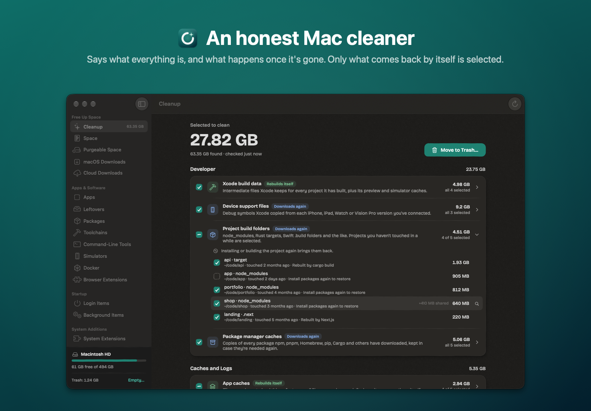
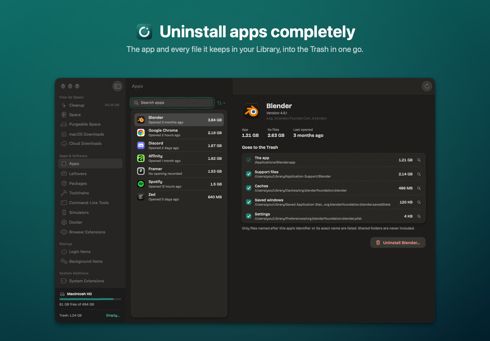
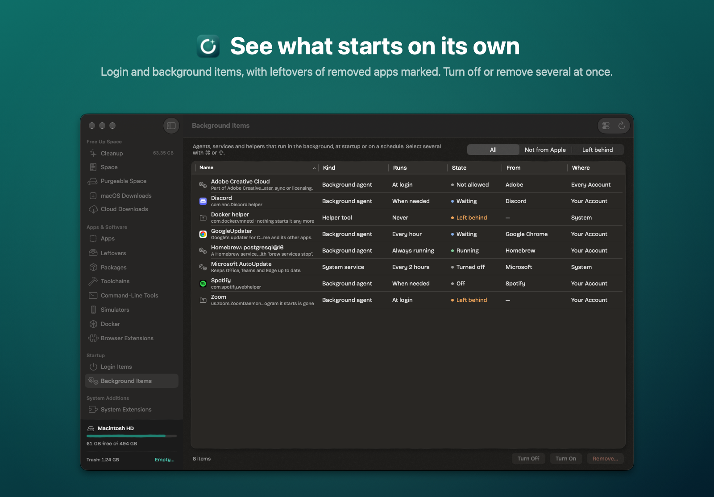
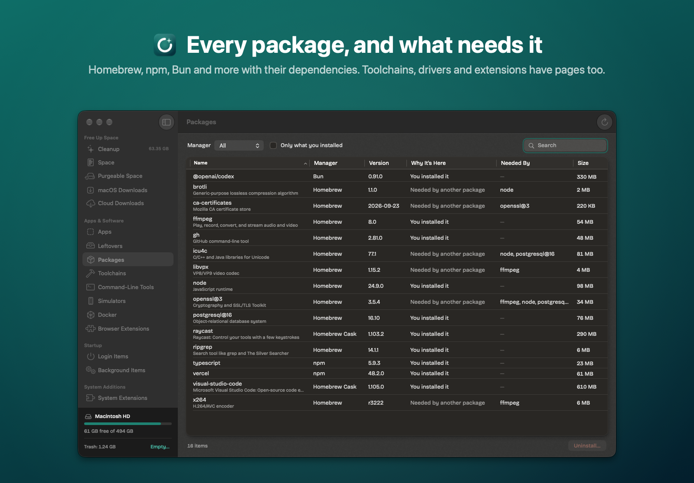

# Spare

An honest Mac cleaner for Apple silicon, macOS 14 or newer. It shows what takes up space, says plainly what each thing is and what happens once it's gone, and moves only what you choose to the Trash.



| | |
|---|---|
|  |  |
|  | |

Screenshots in docs/images are made from sample data: `swift build`, run `.build/debug/Spare -demo YES -section Cleanup -AppleLocale en_US`, capture the window, then `swift scripts/marketing.swift <window.png> <out.png> <headline> <subtitle> work/marketing/icon.png`.

## What it does

Every topic has its own page in the sidebar.

**Free Up Space**
- **Cleanup**: Xcode build data and device support files; node_modules, Rust targets, Swift .build folders and other build folders beside their project file; package manager caches; app caches except macOS's own; logs; crash reports. Things that come back by themselves are selected; caches of open apps, projects touched within a month and anything a running program has open are not. **Your Call** lists old downloads, device backups, Xcode archives and AI models, never selected.
- **Space**: folder sizes from your home folder down.
- **Snapshots**: Time Machine's local snapshots, deleted with `tmutil deletelocalsnapshots` after a password prompt. APFS reports no size per snapshot; emptied ones show zero and the purgeable total is shown.
- **macOS Downloads**: /System/Library/AssetsV2 grouped by feature (Apple Intelligence, dictation, voices, updates). System Integrity Protection guards these; Spare links to the setting that lets macOS remove them.

**Apps & Software**
- **Apps**: each app with the files it keeps in ~/Library, matched by bundle identifier or exact name; uninstalling quits it, stops its login agents and moves everything to the Trash.
- **Leftovers**: files in ~/Library and /Library named after software no installed app, process or background job uses; folders of shortcuts to removed apps in /Applications. In /Library, nothing of macOS's and nothing of a company whose software is still installed is listed.
- **Packages**: Homebrew formulae and casks with what needs what, and global npm, pnpm, Bun, Cargo, uv and pipx packages, removed with each manager's own command.
- **Toolchains**: Rust toolchains and rustup (removed with rustup), Node, Python and Ruby versions, conda, SDKs and Xcode's Command Line Tools.
- **Command-Line Tools**: commands in /usr/local no package manager tracks, with broken links of removed apps and Apple's own shims marked.

**Startup**
- **Login Items** and **Background Items**: tables with multiple selection. Launchd jobs can be turned off (`launchctl disable` + `bootout`), on, or removed; items apps register with macOS (from `sfltool dumpbtm`) link to Login Items settings; helper tools nothing starts are flagged.

**System Additions**: System Extensions (removed only with their app, so each says how), Drivers, Plug-ins, Fonts, Input Methods, Installer Packages (what a receipt still has on disk goes to the Trash and macOS forgets the receipt) and Search Paths (/etc/paths.d). Origin comes from installer receipts and Apple's code signature: macOS's own is locked, Apple's optional additions are labelled.

**System Changes**: hidden Accounts installers created (`dscl . -delete`), added Printers (`lpadmin -x`), VPN configurations and configuration Profiles (changed in Settings), and Privacy permissions given to apps (reset with `tccutil`; needs Full Disk Access to read).

**Home Folder**: Hidden Items in your home folder named by their owner, with keys marked and leftovers of removed tools flagged; the Shared Folder.

**History** lists every move, with Put Back, until the Trash is emptied. **Settings** holds project folders, Full Disk Access and updates.

## Honesty rules

- Nothing is deleted by Spare except when you empty the Trash. Items go to the Trash; History records where each came from. Package managers delete their own packages, and accounts, printers and privacy decisions aren't files; Spare says so before any of these run.
- Everything that needs an administrator in one action goes in one request, through one script per session, so macOS's five-minute grace period applies.
- Nothing a running program has open is offered or moved (open files are read through libproc, as lsof does), so the Trash never ends up holding files an app still writes to.
- Sizes are allocated blocks on disk. A file hard-linked from elsewhere (for example a pnpm store) is shown as shared and not counted as freed. APFS clones can't be told apart, so a cloned file counts in full.
- macOS's own caches, documents, photos, mail and messages are never offered.
- Without Full Disk Access, Spare doesn't open guarded folders at all, so macOS never asks for them one by one; they're shown as locked.
- No background process, no menu bar item, no notifications, no network access except optional update checks.

`.build/debug/Spare --report` prints what a cleanup would find, and `--inventory` what has been added to the Mac, without changing anything.

## Build and verify

Requires the Swift 6.2/macOS 26 SDK; the package uses swift-tools-version 5.9 and macOS 14 deployment.

```sh
swift run SpareChecks
bash scripts/build-app.sh
open dist/Spare.app
```

The app is arm64 with embedded Sparkle 2.10.0, bundle id com.opyuii.spare, and signed with a stable local identity (Spare Local Signing, created once by scripts/signing-identity.sh) so Full Disk Access survives updates. Regenerate the icon with `swift scripts/icon.swift work` followed by `iconutil -c icns work/Spare.iconset -o Sources/Spare/Resources/AppIcon.icns`.

## Releases

Download: https://github.com/lumen-xx/spare-releases/releases/latest. The raw appcast is https://raw.githubusercontent.com/lumen-xx/spare-releases/main/appcast.xml; automatic checks are opt-in.

`updates/config.json` holds the feed and public key; the private key lives only in the login Keychain under account `spare`. `updates/signing-certificate.txt` pins the code signing certificate so Full Disk Access survives updates. Do not generate a replacement for either on an existing release stream. docs/RELEASE_README.md is the release repository's README.

```sh
bash scripts/prepare-release.sh 0.1.1 2
bash scripts/publish-release.sh 0.1.1
```

Build numbers must increase. Source stays private in lumen-xx/spare; binaries are public in lumen-xx/spare-releases.
