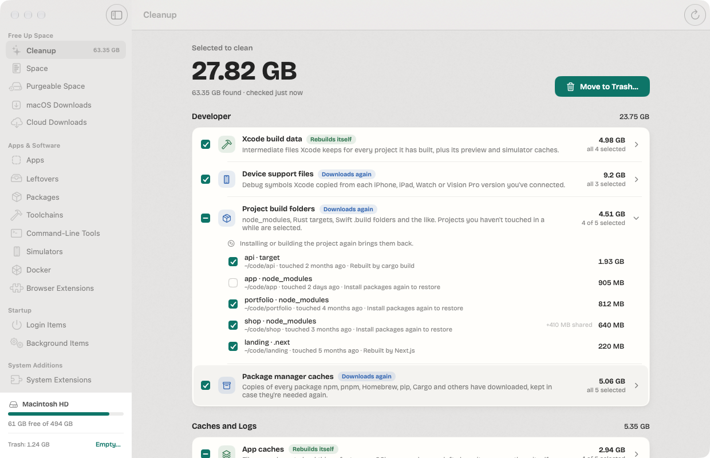
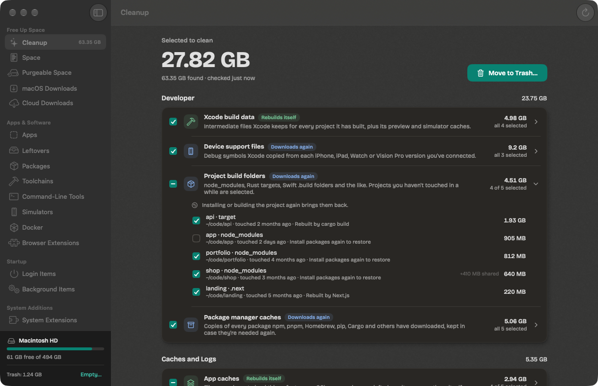
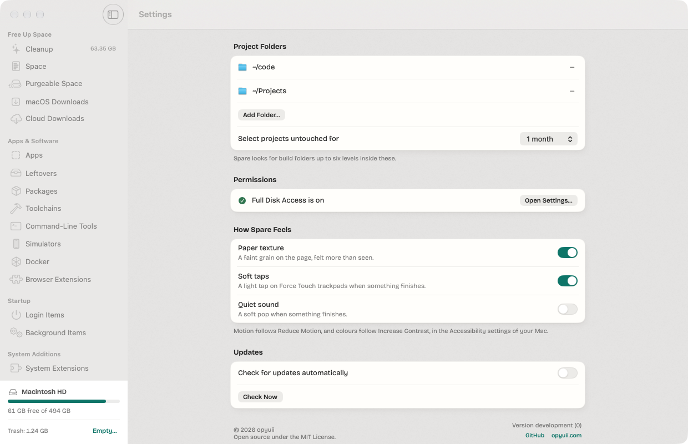
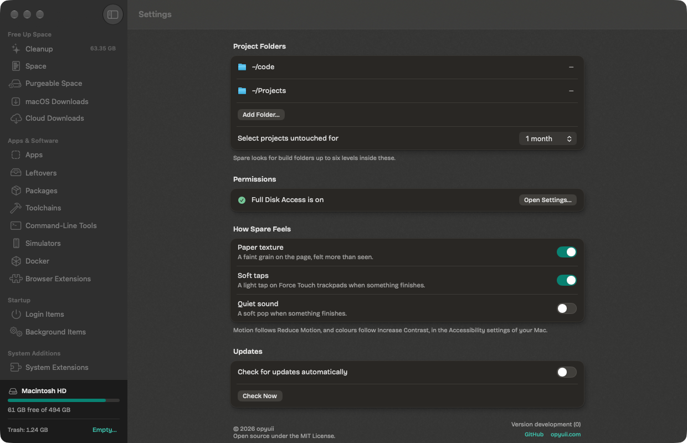
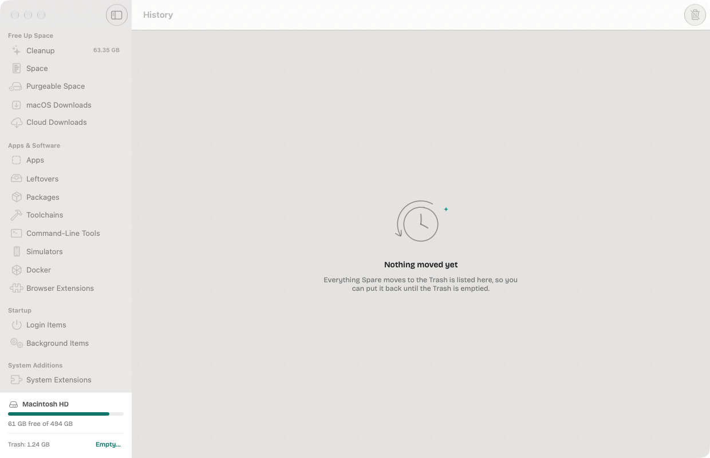
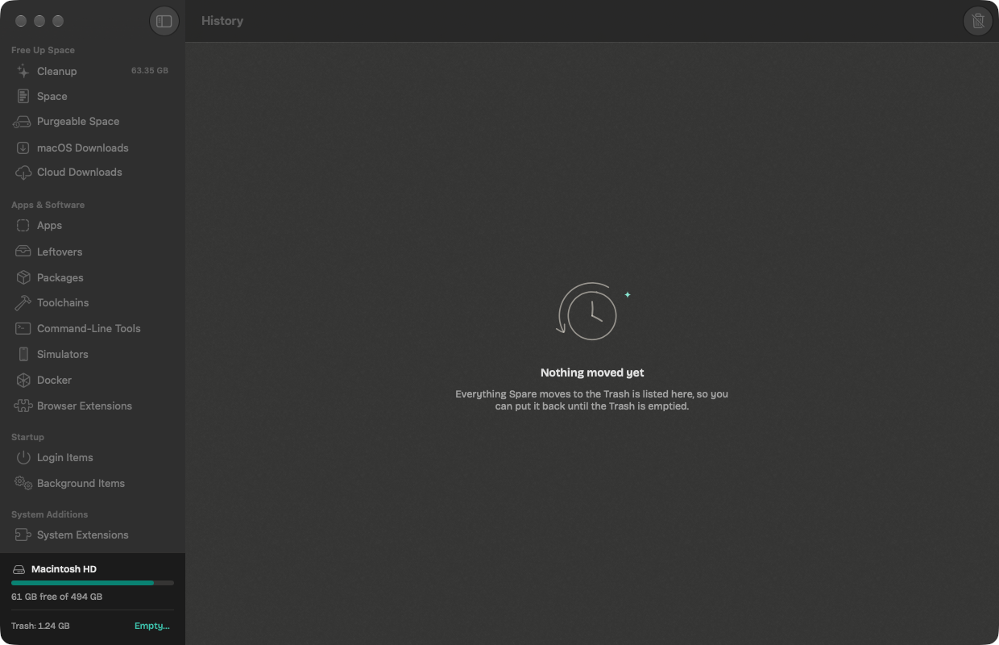
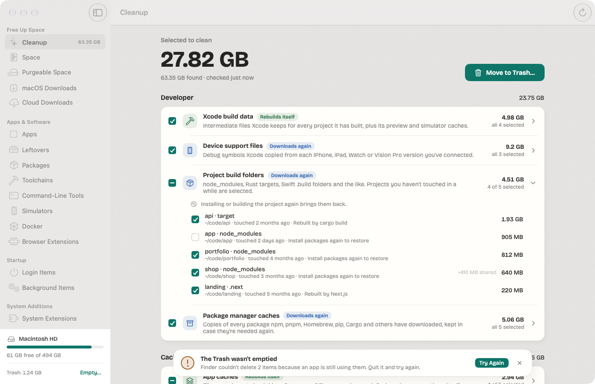
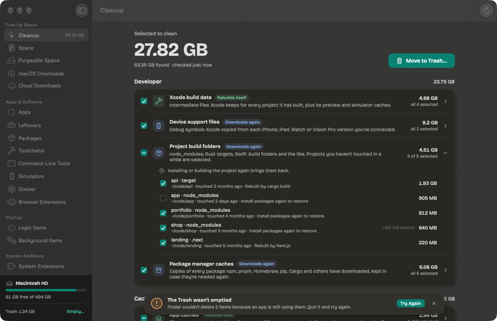

# How Spare looks, moves and feels

**A tidy desk, not a scrapbook.** Spare is a clean, quiet Mac app. Its warmth lives in how things move and how it
answers you. The shapes themselves are even and precise.

The code is in [`Sources/Spare/Design`](../Sources/Spare/Design): colours in `Ink.swift`, the typeface in
`Typeface.swift`, motion in `Motion.swift`, shapes in `Shapes.swift`, paper and shadows in `Paper.swift`,
controls in `Controls.swift`, drawings in
`Doodles.swift` and acknowledgements in `Feedback.swift`. Shared page parts (banners, empty states, headings) are in
`Components.swift`.

## Why it looks like this

Spare moves people's files to the Trash, and that takes trust. Trust comes from clarity: plain words, one obvious
next step, nothing hidden. A sterile utility feels clinical and a busy one feels careless. Spare aims for the calm in
between, more like a well-made notebook than a dashboard.

So the layout is plain macOS, and the personality comes from three places:

1. **Motion.** Springs with a little weight and overshoot. Neighbours never move in lockstep.
2. **Material.** Warm, frosted paper with the desktop showing through, and cards with even, continuous corners and
   a hairline edge.
3. **Acknowledgement.** A beat before a tick lands, a mark drawn when something finishes, a soft tap on the
   trackpad, and the same words for VoiceOver.

### Staying clean: what keeps it from looking like a 2010 web page

- **No texture you can see.** The paper grain is 2.5–3 % and switches off with Increase Contrast.
- **No borders where a fill or spacing will do.** Secondary buttons are a soft grey fill. Card edges are an 8 % hairline.
- **Light shadows only.** They fall down and to the right at 4–6 % in light mode. Never a halo, never a glow.
- **Nothing ornamental.** No gradients, bevels, embossing, stitching or ribbons. One typeface, Bricolage Grotesque,
  in a few weights.
- **Even shapes.** Every corner of a shape has the same continuous radius, and every line is straight and even.
- **Drawings stay in empty states.** They're single pencil-grey lines, used only where there's nothing else to show,
  never as decoration on a working screen.
- **One accent colour.** Amber means "worth a look", never "danger". The red-brown is only for destructive labels.

### What stays macOS

Window chrome and traffic lights, the sidebar, the toolbar, menu bar commands and keyboard shortcuts, SF Symbols,
alerts and confirmations, context menus, native tables with selection, and light and dark. The accent colour is the
person's own: Spare's teal is used only when their accent is set to Multicolour, which is what macOS intends for apps
with a colour of their own. Reduce Motion and Increase Contrast are always respected. Everything Spare draws itself
sits inside the content area.

## The screens

### Main window

| Light | Dark |
| --- | --- |
|  |  |

The page sits on warm, frosted paper. Each group is a card with hairlines between rows. One large number says what
the page is about, and the one primary button sits beside it with its shortcut (⌘⌫). Rules still measuring show
bobbing dots and then settle into their result one by one, each at its own pace. The sidebar is the system's, with the
disk card at the bottom.

### Settings

| Light | Dark |
| --- | --- |
|  |  |

Grouped cards with a title above and a footnote below, as in System Settings, using Spare's switches. **How Spare
Feels** holds the three things that are taste rather than function: paper texture, soft taps and a quiet sound (off
by default). Motion isn't a setting here. It follows Reduce Motion, and the footnote says so.

### Empty state

| Light | Dark |
| --- | --- |
|  |  |

A small single-line drawing that draws itself in, a short title, one sentence on what the page is for, and, when there
is one, the action that would fill it. There are ten drawings (broom, box, sprout, magnifier, moon, clock, cloud, knot,
lock and folder), each in a 120 × 90 box with at most two mint sparkles.

### Error state

| Light | Dark |
| --- | --- |
|  |  |

When something fails, a message is held a little above the page. It has an amber "!", what happened, why
(if known) and the next step as its only filled button: **Try Again**, or **Open Settings…** when a permission is
missing. Problems stay until dismissed. Successes fold away after two seconds, unless the pointer is on them. When a
whole page can't load, it shows a `ProblemNote` instead: the knot drawing, what happened and one button.

Error copy follows one rule: say what happened, why in plain words if known, and the one thing to do next. No error
codes in the headline, and no blame.

## Colour

Text and native controls use macOS's own colours. Spare's colours are for everything around them. Each has a light and
a dark value, and a stronger one with Increase Contrast.

| Token | Light | Dark | Use |
| --- | --- | --- | --- |
| `paper` | `#F7F5F0` | `#1D1C1A` | The page |
| `card` | `#FFFEFB` | `#292724` | Cards lying on the page |
| `lifted` | `#FFFFFD` | `#32302C` | Messages and the action tray, held above the page |
| `line` | ink at 8 % | paper at 10 % | Card edges and dividers (45 % with Increase Contrast) |
| `edge` | ink at 24 % | paper at 26 % | Edges of empty check boxes (70 % with Increase Contrast) |
| `wash` / `press` | 5 % / 9 % | 6.5 % / 12 % | Hover and pressed fills, grey buttons, empty tracks |
| `pencil` | `#3A352E` at 50 % | `#E9E3D8` at 55 % | Drawings |
| `brand` | `#1E7568` | `#1F8272` | Accent fills (white text on it: 5.5:1 and 4.7:1) |
| `brandText` | `#1E7568` | `#4CC3AD` | Accent as text, such as quiet buttons |
| `sage` / `ink` / `sea` | `#36754D` / `#3768B4` / `#257470` | `#7CC796` / `#86AEEA` / `#6FD0C8` | How safe a cleanup is: rebuilds itself, downloads again, regenerated |
| `warm` | `#9A5916` | `#F2A65A` | Worth a look: locked, in use, nearly full |
| `brick` | `#AC4B34` | `#F09480` | Destructive button labels |
| `shade` | `#2A1F14` | black | What shadows are made of: brown-black on paper, not grey |

## Type

Spare uses **Bricolage Grotesque**, the typeface of [nano](https://nano.opyuii.com), bundled with the app under the SIL
Open Font License. It's a variable font, and `Font.spare(size:weight:)` sets every axis: the weight asked for, the
normal width, and an optical size equal to the point size (12–96). So 11 pt captions get its open, sturdy text cut and
the big number on a page gets its tighter display cut. Characters outside Latin come from its Latin Extended half,
then from the system font. SF Symbols, and the monospaced bundle identifiers on the Apps page, stay in the system
font.

| Use | Size | Weight |
| --- | --- | --- |
| The one big number on a page | 46 pt (30 pt on Space) | Bold |
| An app's name on Apps | 22 pt | Bold |
| Section headings | 14 pt | Semibold |
| Row names | 12.5–13 pt | Medium or Semibold |
| Body text and details (13 pt unless set) | 11.5–13 pt | Regular |
| Captions and notes | 10.5–11 pt | Regular |

Sizes and counts use `.monospacedDigit()`, so numbers don't shift as they roll.

## Motion

### Principles

1. **Input never waits.** State changes in the same frame as the click, key or VoiceOver action. Pauses only hold
   back the drawing of an acknowledgement, never the result. Typing, scrolling, dragging and shortcuts get no delay.
2. **Springs, not curves.** Every animation is a spring, chosen for what it does, except under Reduce Motion.
3. **Nothing moves in lockstep.** The same motion runs up to 8 % faster or slower depending on what's moving
   (`Motion.varied`), and lists arrive 35 ms apart, ±9 ms.
4. **Nothing moves while idle.** Repeating animations run only while Spare is working, so it uses no CPU when idle.
5. **Reduce Motion means calm.** Every scale, offset and bounce becomes a 0.2 s crossfade.

### Springs

| Name | Response | Damping | Used for |
| --- | --- | --- | --- |
| `press` | 0.20 s | 0.55 | A button or check box going down |
| `release` | 0.32 s | 0.60 | Coming back up with a small overshoot |
| `settle` | 0.42 s | 0.80 | Check boxes, switches, a rule finishing |
| `arrive` | 0.55 s | 0.72 | Page parts arriving |
| `panel` | 0.50 s | 0.66 | Messages sliding in from the bottom |
| `bounce` | 0.34 s | 0.45 | A finished task's mark landing |
| `expand` | 0.38 s | 0.86 | Opening a group of rows (layout moves, so barely any overshoot) |
| `draw` | 0.62 s | 1.0 | A pen drawing a line: it slows into the end and never overshoots |
| `count` | 0.45 s | 0.90 | Numbers rolling to a new value |
| `hoverIn` | 0.28 s, after 60 ms | 1.0 | Noticing the pointer |
| `hoverOut` | 0.18 s | 1.0 | Letting it go, quicker |
| `calm` | 0.2 s ease in-out | | Everything, with Reduce Motion |

### Beats

Deliberate pauses before an acknowledgement, all between 40 and 120 ms:

| Beat | Length | Where |
| --- | --- | --- |
| `tick` | 50 ms | A check box considering before its tick draws |
| `toggle` | 60 ms | A switch's knob deciding before it slides |
| `settle` | 80 ms | A count or a row settling after a change |
| `breath` | 120 ms | The pause before a success mark is drawn |

### Interactions

| Moment | Motion |
| --- | --- |
| Page appears | Each part rises 8 pt and fades in with `arrive`. Nothing grows, and tables only fade, so a table never stretches as it arrives. Each follows 35 ms after the one before (±9 ms), with no extra wait past the tenth. When an empty list fills, it arrives again. Anything already on screen never blinks. |
| Button press | Squashes to 101.5 % wide and 95 % tall with `press`, then springs back with `release`. Primary buttons darken by 14 %. |
| Hover | A soft wash fades in 60 ms after the pointer arrives, and leaves faster than it came. Row actions such as Show in Finder fade in the same way. |
| Check box | Squashes to 106 % × 90 %. After `tick`, the tick draws itself (`draw` at 1.8× speed) and the box bounces 1 → 1.12 → 1. A group's mixed state shows a dash. |
| Switch | After `toggle`, the knob slides with `settle`. It stretches from 16 to 20 pt wide while pressed. |
| Expanding a rule | Rows fade in from 6 pt above with `expand`, and the chevron turns with them. |
| Measuring | Three dots bob 130 ms apart (±8 %), then the result settles in after `settle`, each rule at its own speed. Sizes roll to their value. |
| Something finishes | The message slides up with `panel`. After `breath`, a circle draws itself, then a tick (or an amber "!"), and the mark bounces to 1.14. With the tick comes a soft trackpad tap and, if chosen, a quiet sound. |
| Full Disk Access granted | The note turns into a thank-you with a drawn tick, then folds away after 2.8 s. |

## Texture and shadow

### Paper grain

One 256-pixel tile is made at launch from a fixed seed and repeated across the page at 2×, so it costs a single image
and no work per frame. It blends 60 % fine noise with 40 % soft 5 × 5 clumps, wrapping at the edges so tiles meet
without seams. Light and dark specks balance out, so the paper keeps its colour. It's drawn at 2.5 % opacity in
light mode and 3 % in dark mode, and switches off with Increase Contrast or the **Paper texture** setting. There are
no fibres or stains, and nothing you'd notice in a screenshot.

### See-through paper

The paper is frosted glass. Behind it, macOS blurs whatever is under the window with its sidebar material
(`NSVisualEffectView`, `.sidebar`, blended behind the window), and the paper lies over that at 30 % in light mode and
35 % in dark mode: enough to keep its warmth, little enough to see the desktop's colours through it. It stays frosted
while the window is in the background. Cards stay solid. With Reduce Transparency or Increase Contrast it's solid
paper. The blur is drawn by the window server, so it costs Spare nothing per frame.

### Surfaces

Three levels: the **paper**, **cards** lying on it (lift 1), and things **held above** it, such as messages (lift 2.2)
and the action tray (lift 1.6).

### Desk shadow

Light comes from the upper left, as on a desk under a window, so a shadow is almost absent along the top and left and
falls down and to the right. It's never a centred halo.

| | Value |
| --- | --- |
| Shadow body | The card's own shape, inset 5 × lift at the top and 3 × lift at the leading edge, extended 1.2 × lift to the right and 2.6 × lift at the bottom. |
| Offset and blur | (0.8, 1.6) × lift, blur 5 × lift |
| Opacity | 4 % + 1.5 % × lift in light mode, 26 % + 3 % × lift in dark mode |
| Contact line | The same shape offset (0.2, 0.6), blur 0.6, at 4.5 % light or 30 % dark: the faint line where card meets paper |
| Colour | Brown-black (`shade`) in light mode, like shade on paper; black in dark mode |

### Shapes

Surfaces are `RoundedRectangle.continuous(_:)`, the same squircle corners macOS uses.

| Part | Corner radius | Line |
| --- | --- | --- |
| Card | 12–14 pt | 0.75 pt hairline (1.25 pt with Increase Contrast) |
| Message, tray | 14–16 pt | 0.75 pt hairline |
| Button | 7–10 pt | none (1.2 pt edge with Increase Contrast) |
| Check box | 4.5 pt | 1.2 pt (1.6 pt with Increase Contrast) |
| Switch track, tag, usage bar | capsule | 1 pt on the switch when off; tags and bars are fill only |
| Symbol tile | 30 % of its size | fill only, accent at 12 % |
| Divider | | 1 pt |

## Building with it in SwiftUI

### A page

```swift
struct ExampleView: View {
    let rows: [Row]

    var body: some View {
        PageScroll {                                   // centred column on the paper; parts arrive in order
            SectionHeading(title: "Caches", subtitle: "They rebuild themselves") {
                SizeText(bytes: total)                 // rolls to new values
            }
            .arrives(0)
            Card {
                ForEach(Array(rows.enumerated()), id: \.element.id) { index, row in
                    if index > 0 { RowDivider().padding(.horizontal, 12) }
                    RowView(row: row)
                        .hoverWash()
                }
            }
            .arrives(1)
            Button("Move to Trash…") { confirm() }
                .spareButton(.primary)
                .controlSize(.large)
                .arrives(2)
        }
    }
}
```

### Parts

| Part | What it does |
| --- | --- |
| `PageScroll(maxWidth:spacing:replay:)` | Scrolling page column, centred, without scroll bars, and an arrival stage |
| `.arrivalStage(replay:)` / `.arrives(_:rise:)` | Parts of a page arriving in order, again when `replay` turns false. Tables use `rise: 0`, so they only fade. |
| `Card(radius:lift:fill:)` | Card with hairline and desk shadow |
| `TableCard` | A native `List` on a card, with no stripes or scroll bars |
| `RowDivider()` | Hairline between rows |
| `.spareButton(.primary / .secondary / .quiet / .icon)` | Buttons with squash, hover lag and focus ring. `role: .destructive` turns the label red-brown. |
| `CheckBox(state:action:)`, `SpareCheckStyle()` | Check box with a mixed state, and the same as a `Toggle` style |
| `SpareSwitchStyle()` | Switch for settings |
| `Tag`, `SafetyPill`, `SymbolTile`, `UsageBar`, `SizeText` | Small parts |
| `ThinkingDots()` | Shown while working. They repeat only while on screen. |
| `.hoverWash(radius:)`, `.hoverLag(_:)` | Noticing the pointer, with the soft lag |
| `EmptyState(doodle:title:text:actions:)` | A page with nothing to show |
| `ProblemNote(title:text:actionTitle:action:)` | A page that couldn't load |
| `Shared.banner = .init(title:detail:…, next: .init(title:) { … })` | A message with its next step |
| `DoneMark(warning:)` | The drawn tick or "!" |
| `Feedback.finished(_:success:)`, `Feedback.announce(_:)` | Soft tap, optional sound and VoiceOver announcement |
| `Motion.*`, `Beat.*`, `Stagger.delay(_:)`, `Motion.varied(_:_:)`, `Motion.gentle(_:reduceMotion:)` | Timing |
| `Ink.*` | Colours |
| `Font.spare(size:weight:)` | The typeface. Use it for all text; keep `.system` for SF Symbols. |
| `PaperBackground()` | The frosted paper, for a window or sheet's background |

### Rules of thumb

- **Delay the drawing, not the state.** Put the beat on the animation, `.animation(Motion.settle.delay(Beat.tick),
  value:)`, and never on the model with `asyncAfter`.
- **Check Reduce Motion** for every scale, offset or bounce, or use `Motion.gentle(_:reduceMotion:)`. Read it as
  `@Environment(\.reduceMotion)`, Spare's own key. The window's root passes the system setting down through it,
  so a development build can be checked with `-reduceMotion YES` without changing the Mac's settings.
- **Nothing repeats while idle.** A `repeatForever` animation may only live in a view that's shown while work is
  happening.
- **No vertical `fixedSize` on wrapping text outside a scroll view.** It can make the window's content taller than
  the window. Use `lineLimit` instead.
- **Acknowledge in one call.** `Feedback.finished(message)` taps, plays the optional sound and tells VoiceOver.

## Accessibility

### Reduce Motion

Every scale, offset, squash, bounce and draw-on becomes a 0.2 s crossfade. Pages appear without rising, drawings
appear already drawn, messages fade instead of sliding, and the thinking dots fade instead of bobbing. Beats remain,
since they're under 120 ms and carry no movement. To check it, run a development build with `-reduceMotion YES`.

### Reduce Transparency

The paper is solid and nothing behind the window shows through. The sidebar follows macOS.

### Increase Contrast

The paper becomes solid white (or near-black), the grain disappears, hairlines go from 8 % to 45 %, control edges to 70 %,
and every colour switches to a deeper (light mode) or lighter (dark mode) variant. Secondary buttons get an edge.

### Colour contrast

In standard mode, all of Spare's coloured text reads at **4.5:1 or more** on the solid paper, a card, a grey button and its
own tag, in both light and dark (WCAG AA for small text). White on the teal fill is 5.5:1 in light mode and 4.7:1 in
dark mode. Unchecked check box edges follow macOS's own subtle style in standard mode, and Increase Contrast raises
them above 3:1. Meaning is never carried by colour alone: every safety colour comes with words ("Rebuilds itself"),
and every warning with a symbol and a sentence.

### VoiceOver

- Check boxes and switches are real toggles to VoiceOver (`accessibilityRepresentation`), with values such as
  "partly checked".
- Section titles are headings, so the rotor can jump between groups.
- Drawings, grain, shadows, dividers and symbol tiles are hidden from VoiceOver. The thinking dots read as "Working".
- What a message shows is announced, without moving the VoiceOver cursor. So is a finished scan: "Scan finished.
  Found 60 GB; 25 GB selected."
- Icon-only buttons have labels ("Dismiss", "Show items", "Stop looking in dev").

### Keyboard

- Spare's own controls draw a focus ring in the accent colour, in place of the system's rectangle. Native
  controls keep the system's ring. Turn on Keyboard navigation in System Settings to move focus to every control.
- Shortcuts: ⌘⌫ moves what's selected to the Trash (after asking), ⌘R scans again, ⇧⌘⌫ empties the Trash (after
  asking), ⌘, opens Settings, and Return opens a folder on the Space page.
- Every action is a button, a menu item or a context menu item. None of them depend on hover.

## Tone check

When reviewing a screen, ask:

- **Does it feel slow?** Remove the delay. Beats are only for acknowledgements, and anything over 120 ms is a bug.
- **Does it feel sloppy?** Make it more consistent: the same radius for the same thing, aligned edges.
- **Does it feel sterile?** Add warmth through motion or words, not decoration.
